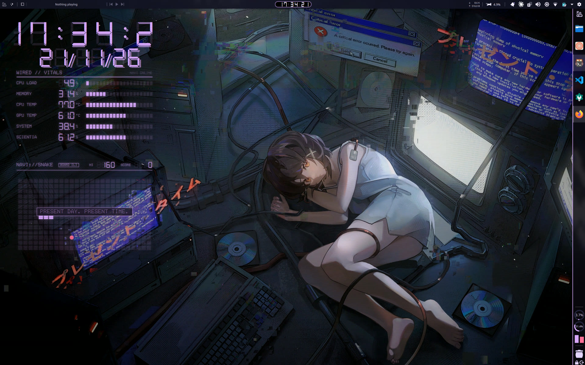
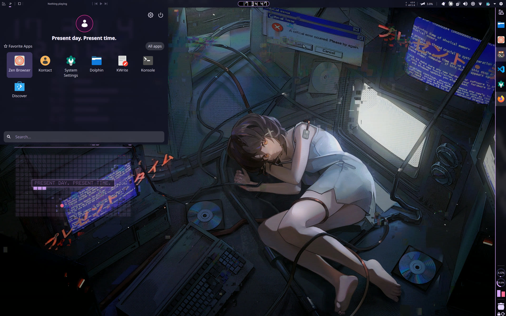
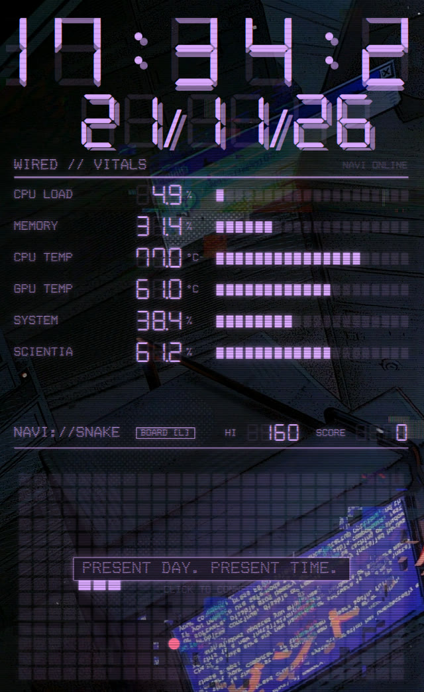
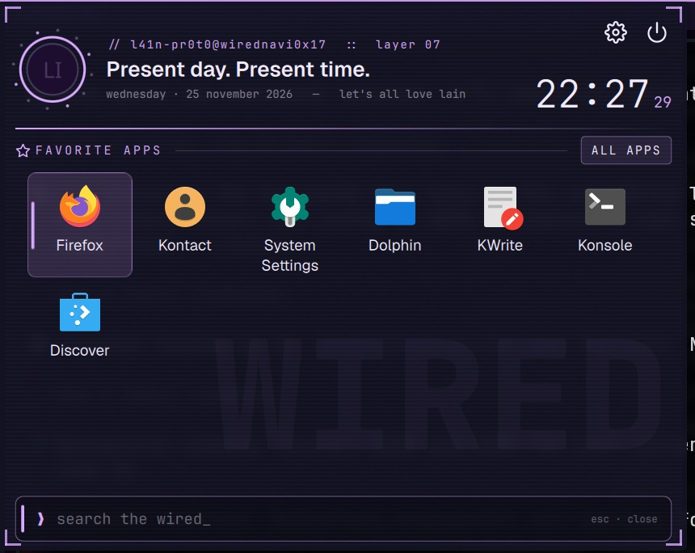
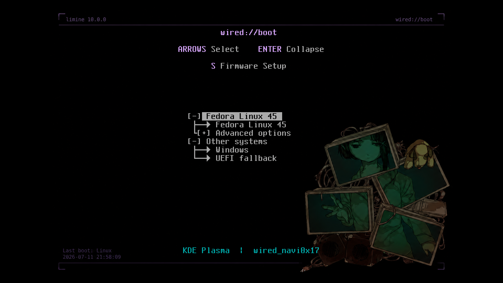
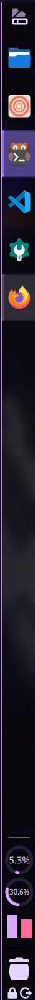

# Fedora-2026

My KDE Plasma desktop on Fedora 45: a dark violet "Lain / Wired" look with NieR:Automata touches, two floating-style panels, a few custom widgets, a video wallpaper and shader-based window effects.

Everything needed to rebuild it is in this repo or linked from it. No personal data is included. The wallpapers are not bundled (see [docs/WALLPAPER.md](docs/WALLPAPER.md)).

<p align="center">
  
</p>

## Gallery

<p align="center">
  
  <br/><sub>Andromeda launcher open over the desktop</sub>
</p>

<p align="center">
  
  &nbsp;
  
  <br/><sub>Left: Reloj LCD clock, Wired Vitals and Wired Snake (my widgets). Right: the Meta menu, Andromeda restyled as "Wired" (live clock, mono labels, violet accents, scanlines).</sub>
</p>

### Bootloader

<p align="center">
  
  <br/><sub>Limine 10 under Secure Boot (shim → MOK-signed Limine). Config and sync script: <a href="boot-login/limine/">boot-login/limine/</a></sub>
</p>

### Top panel

<p align="center">
  
</p>
<p align="center">
  
  
  <br/><sub>Zoomed: left side (launcher, Chorus media) and right side (netspeed, CatWalk, tray, Control Station)</sub>
</p>

<details>
<summary><b>Right panel</b> (tasks, CPU / RAM / temperature rings, trash, lock)</summary>
<p align="center">
  
</p>
</details>

> A demo video is still to be added.

## Tested on

| | |
|---|---|
| OS | Fedora Linux 45 (KDE Plasma Desktop Edition) |
| Plasma / KWin | 6.8.3, Wayland |
| Display | 2560x1600 @ 240 Hz, scale 125% |
| Hardware | Lenovo Legion laptop (hardware-specific fixes live in [docs/LEGION-EXTRAS.md](docs/LEGION-EXTRAS.md), not needed for the look) |

Other Plasma 6 versions may work, but widgets such as Panel Colorizer and Better Blur DX track KWin closely. Use the versions in [widgets/WIDGETS.md](widgets/WIDGETS.md).

## What's in the look

| Part | What I use | In this repo? |
|---|---|---|
| Colour scheme | LainWired (+ LainAmoled, LainObsidian, Nier-Automata) | yes: `plasma/color-schemes/` |
| Widget style / window decoration | Darkly | link |
| Icons | Papirus, violet folders | link |
| Cursor | catppuccin-frappe-pink | link |
| Fonts | JetBrainsMono Nerd Font, Geist, Google Sans Flex, Material Symbols | list: [packages/fonts.md](packages/fonts.md) |
| Wallpaper | Lain video loop via Smart Video Wallpaper Reborn | plugin: link, media: no |
| Blur | Better Blur DX (strength 3, applied to kitty, krunner, plasmashell, Zen) | link + settings |
| Alt-Tab | CoverSwitch2 | link + settings |
| Window effects | 43 shader effects (dissolve, glitch, ripple, smoke...) | yes: `kwin/effects/` |
| Lock screen | NieR look-and-feel package | yes: `plasma/look-and-feel/` |
| Login screen | SDDM "nier-automata" | QML yes, media no: [docs/BOOT-LOGIN.md](docs/BOOT-LOGIN.md) |
| Meta menu | Andromeda Launcher, "Wired" restyle | yes: `widgets/AndromedaLauncher-wired/` |
| Bootloader | Limine, Lain background | yes: `boot-login/limine/` + [docs/BOOT-LOGIN.md](docs/BOOT-LOGIN.md) |
| Terminal / shell | kitty, fish, fastfetch | [dotfiles-cachyos](https://github.com/l41n-pr0t0/dotfiles-cachyos) |

## Panel layout

There are two panels and some desktop widgets. Both panels are styled by Panel Colorizer with a custom NieR preset: parchment `#d8d2b8` at 85% with blur, dark ink text, and a sepia rule line.

```
┌──────────────────────────────────────────────────────────────────────────────┬────┐
│ TOP PANEL  28 px                                                             │    │
│ Andromeda │ Chorus │        [ digital LCD clock ]        │ netspeed │ CatWalk │    │
│ launcher  │ (media)│                                     │ tray  │ Control Station │
├──────────────────────────────────────────────────────────────────────────────┤ R  │
│                                                                              │ I  │
│  DESKTOP WIDGETS: Reloj LCD clock · Wired Vitals · Wired Snake               │ G  │
│                                                                              │ H  │
│                                                                              │ T  │
│                                                                              │    │
│                                                                              │ 44 │
│                                                                              │ px │
└──────────────────────────────────────────────────────────────────────────────┴────┘
```

**Top panel** (28 px, top edge, always visible), left to right:
1. Panel Colorizer (invisible, styles the panel)
2. Andromeda Launcher
3. Latte Separator
4. Chorus (media controls)
5. spacer
6. Reloj LCD Retro (digital clock, centred)
7. spacer
8. Netspeed Widget
9. Latte Separator
10. CatWalk (running cat CPU indicator)
11. Latte Separator
12. System tray
13. KDE Control Station
14. spacer

**Right panel** (44 px, right edge, always visible), top to bottom:
1. Panel Colorizer (invisible)
2. Icons-only Task Manager
3. spacer
4. Latte Separator
5. CPU ring, memory ring (system monitor sensors)
6. System monitor with two temperature rings (CPU / GPU)
7. Latte Separator
8. Trash
9. Lock / Logout

**System tray contents:** Vault, KDE Connect, Clipboard, Network, Weather, Volume, Bluetooth, Battery, Brightness, Media player, Notifications, Display configuration, Keyboard layout and indicators, Camera indicator, Devices, Printers.

**Desktop widgets:** Reloj LCD Retro, Wired Vitals, Wired Snake (the last two are mine, in `widgets/`).

The exact layout is in [`plasma/appletsrc.template`](plasma/appletsrc.template), with home paths replaced by `@HOME@`.

## Widgets

| Widget | Where | Version | Source |
|---|---|---|---|
| Panel Colorizer | both panels | 8.1.0 | [luisbocanegra/plasma-panel-colorizer](https://github.com/luisbocanegra/plasma-panel-colorizer) |
| Andromeda Launcher | top | 0.6 | [EliverLara/AndromedaLauncher](https://github.com/EliverLara/AndromedaLauncher) |
| Chorus | top | 2.11.1 | [Netherizzium/chorus](https://github.com/Netherizzium/chorus) |
| Reloj LCD Retro | top + desktop | 1.9.2 | [KDE Store](https://store.kde.org/p/2363962) |
| Netspeed Widget | top | 3.1 | [dfaust/plasma-applet-netspeed-widget](https://github.com/dfaust/plasma-applet-netspeed-widget) |
| CatWalk | top | 2.4 | KDE Store |
| KDE Control Station | top | 2.11.0 (patched) | [EliverLara/kde-control-station](https://github.com/EliverLara/kde-control-station/tree/plasma6), patched copy in `widgets/` |
| Latte Separator | both | 0.1.1 | [psifidotos/applet-latte-separator](https://github.com/psifidotos/applet-latte-separator) |
| Wired Vitals | desktop | 1.0 | mine, `widgets/org.wired.vitals` |
| Wired Snake | desktop | 1.0 | mine, `widgets/org.wired.snake` |
| Icons-only Task Manager, System Monitor, Trash, Lock/Logout, System Tray | panels | stock Plasma | built in |

Details and install notes: [widgets/WIDGETS.md](widgets/WIDGETS.md).

## Install

> Read [docs/DEPENDENCIES.md](docs/DEPENDENCIES.md) first and install the third-party pieces. The script does not download them.

```bash
git clone git@github.com:l41n-pr0t0/Fedora-2026.git
cd Fedora-2026
./install.sh --dry-run     # see what it would do
./install.sh               # theme files, own widgets, effects, settings
```

Everything it overwrites is backed up to `~/.local/share/fedora-2026-backup/<timestamp>/`. Settings are merged key by key, so your other settings stay.

### Applying the panel layout

Plasma rewrites its config when it exits, so the layout can't be swapped while the desktop runs. The script refuses to do it unless plasmashell is stopped:

1. Log out. Press `Ctrl+Alt+F3` and log in on the TTY.
2. `cd Fedora-2026 && ./install.sh --layout`
3. Log back in (`Ctrl+Alt+F1` or `F2`).

All widgets used in the layout must already be installed, or Plasma drops them.

### Login screen

```bash
./install.sh --sddm       # uses sudo
```

You supply the background media, see [docs/BOOT-LOGIN.md](docs/BOOT-LOGIN.md).

### Doing it by hand

[docs/MANUAL-INSTALL.md](docs/MANUAL-INSTALL.md) lists the same steps without the script.

## Customising

- **Wallpaper:** the layout expects `~/Pictures/Wallpapers/lain-wired-live.mp4` (video) and `lain-wired-exkqk8.jpg` (still). Either use those names or change the paths in the Wallpaper settings.
- **Accent colour:** `167,139,250` (violet). Change in System Settings > Colours.
- **Panel style:** right-click the panel > Panel Colorizer, or edit the preset JSON inside the applet config.
- **Window effects:** System Settings > Desktop Effects. The shader effects are listed by name there.

## Troubleshooting

- **Panels missing after login.** Usually a leftover shell override from another Plasma version. Check `~/.local/share/plasma/shells/` and move `org.kde.plasma.desktop` out. This broke my taskbar when I moved from NixOS on Plasma 6.6 to Fedora on 6.8.
- **A widget shows an error icon.** It isn't installed or is built for another Plasma version. Check [widgets/WIDGETS.md](widgets/WIDGETS.md).
- **Blur does nothing.** Better Blur DX must match your KWin version. Rebuild it, then log out and in.
- **Layout didn't apply.** plasmashell was running. Use the TTY steps above.

## Privacy

This repo is checked with `tools/privacy-scan.sh` before each commit. Machine UUIDs, monitor IDs, network config, tokens, SSH/GPG material and browser data are never copied.

## Credits and licences

Third-party work belongs to its authors under their own licences: Darkly (Bali10050), Papirus, Catppuccin cursors, Panel Colorizer, Andromeda Launcher, Chorus, Reloj LCD Retro, Netspeed, CatWalk, Latte Separator, KDE Control Station, Better Blur DX, CoverSwitch2, Smart Video Wallpaper Reborn. The shader effects in `kwin/effects/` are by liixini and mj0x0 (MIT). The SDDM theme is based on the "Qylock" nier-automata theme by Darkkal44. Wallpapers and character art belong to their original creators.

My own scripts and configuration are under the [MIT licence](LICENSE). Wired Vitals and Wired Snake stay GPL-2.0+ as declared in their `metadata.json`. KDE Control Station is GPLv3.

Terminal, shell and bootloader dotfiles: [dotfiles-cachyos](https://github.com/l41n-pr0t0/dotfiles-cachyos).
