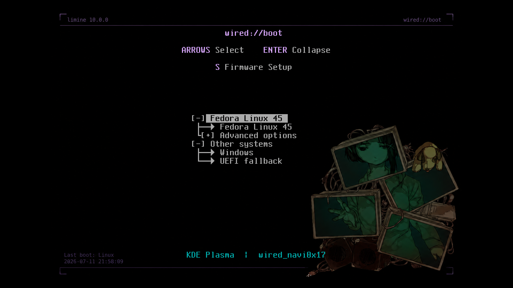

# Login screen and bootloader

## SDDM: nier-automata

`boot-login/sddm/nier-automata/` holds the QML, `theme.conf` and `metadata.desktop`. The background video, image and fonts are not included.

1. Install the base theme (the "Qylock" nier-automata theme by Darkkal44) or create the folder yourself.
2. `./install.sh --sddm` copies the QML and `/etc/sddm.conf.d/10-nier.conf`.
3. Add your own `bg.mp4`, `bg.png` and a `font/` folder to `/usr/share/sddm/themes/nier-automata/`.
4. Test without logging out: `sddm-greeter-qt6 --test-mode --theme /usr/share/sddm/themes/nier-automata`.

`10-nier.conf` sets the theme to `nier-automata` and the cursor to `catppuccin-frappe-pink-cursors`.

## Limine

I boot through Limine on Fedora with Secure Boot on. My files are in `boot-login/limine/`:

| File | Installed at | What it does |
|---|---|---|
| `limine.conf` | `/boot/efi/limine/limine.conf` (copy in `\EFI\limine\`) | The menu: theme options and the Fedora / Advanced / Other systems tree. It is generated, so don't hand-edit it on the machine |
| `limine-sync` | `/usr/local/sbin/limine-sync` | Builds `limine.conf` from Fedora's BLS entries, copies kernels to the ESP, enrolls the config hash and MOK-signs Limine |
| `95-limine.install` | `/etc/kernel/install.d/` | kernel-install hook: reruns `limine-sync` on kernel add/remove |

The config contains my partition UUIDs, file hashes and kernel cmdline (NVIDIA / Legion options). On another machine, keep the theme block at the top (`wallpaper`, `interface_branding*`, `term_font_scale`, `backdrop`) and let `limine-sync` generate the rest. Edit `WIN_UUID` and the cmdline in `limine-sync` first. The wallpaper (`lain.png`) is not included.

The config hash is enrolled into the signed binary. If you edit `limine.conf` without rerunning `limine-sync`, Limine panics with "CHECKSUM MISMATCH FOR CONFIG FILE".

The screenshot comes from booting the same signed Limine binary, config and wallpaper in QEMU/OVMF.

Limine's own docs: https://github.com/Limine-Bootloader/Limine/blob/v12.x/CONFIG.md

Gotcha under Fedora's shim: Limine needs an `.sbat` section or shim refuses to load it ("Verification failed: Security Violation"). Add one with `objcopy --add-section .sbat=...` before signing.
